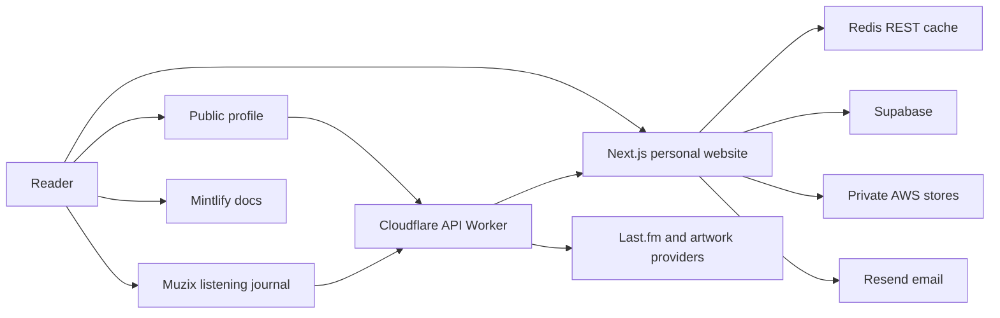

AVRXT is one person’s website with a few focused applications. These are maintenance boundaries, not customer tenants or product tiers.

## Repository responsibilities

| Repository | Responsibility |
| --- | --- |
| `avrxt.dev` | Main Next.js website and shared Worker source |
| `avrxt-me` | Separately hosted public profile |
| `avrxt-muzix` | Music journal and monthly snapshot automation |
| `avrxt-docs` | Mintlify configuration, documentation, and checks |

## Data ownership

Supabase stores selected website configuration and workflow records. DynamoDB stores private notes. S3 backs personal storage, and R2/CDN assets support public media. Redis is a cache and rate-limit dependency, not the source of truth for personal records.

## Change boundaries

The shared gateway serves more than one frontend. Before changing a contract or cache rule, check its profile, Muzix, and main-site consumers. A main-site deployment does not prove the separately hosted profile or music interface deployed.

## Related reading

- [Deployment](/maintaining/deployment)
- [Cache policy](/maintaining/caching)
- [Environment configuration](/maintaining/configuration)

