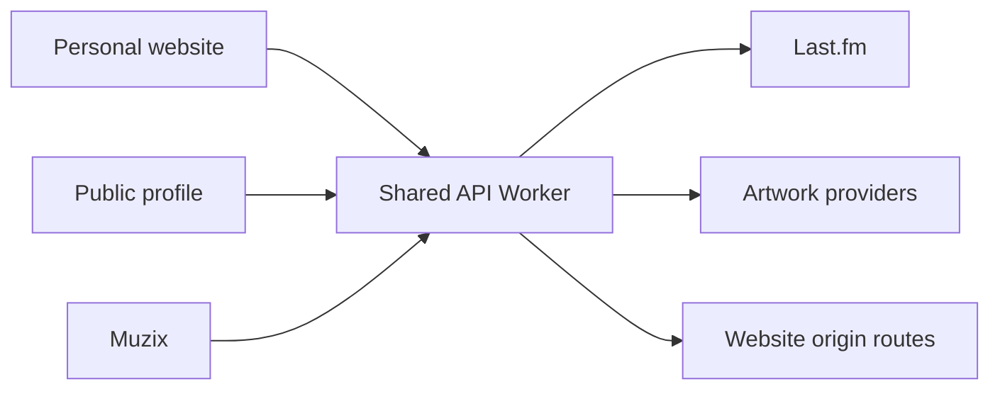

These notes describe the implementation behind avrxt’s personal website. They are based on the checked-out source, not a claim that every prepared change is already deployed. See the [technical log](/notes/technical-log) for release status.

## One identity, separate applications

The main website, public profile, and Muzix have separate release boundaries. A shared Worker at `api.avrxt.dev` supplies selected public data. This avoids duplicating provider integration logic across frontends, but makes response compatibility important: a gateway change can affect more than one website.

The useful lesson is to share a narrow data contract rather than assuming every frontend deploys together. Keep origin policy and caching rules explicit. See [architecture](/maintaining/architecture) and [cache policy](/maintaining/caching) for the detailed boundaries.

## Muzix: activity is a reported signal

Muzix uses Last.fm listening history. A currently-playing state exists only when the scrobbling source reports it. When that signal is absent, recent history remains useful, but it must not be presented as a guaranteed live playback session. Recent activity has a short internal cache; charts and artwork have different freshness needs.

Artwork is another independent concern. Track metadata can fall back to verified Apple matches, while artist images use exact-name matching through Deezer. Missing artwork should leave a readable track or artist entry. A plausible-looking but incorrect image is not an improvement over an honest placeholder. Read [artwork behavior](/api-reference/artwork) for matching limits.

## A profile that can survive partial failure

The profile presents enabled public links and widgets. Music, presence, and media are supplementary signals rather than reasons to hide the whole identity page. When working on such a page, test missing images, unavailable upstream data, and long labels alongside the normal state. Keep public profile configuration separate from administrative access.

## Documentation as a separate release

The prepared migration removes the embedded main-site docs editor, preserves the original articles, and moves the reading experience to Mintlify. Redirects must be released after the new hostname works. A successful local build alone cannot establish that a custom domain, deployment, and old links are ready.

For your own project, record the source revision, changed contract, consumers checked, and rollback plan. That small record is more useful than an architecture diagram that silently becomes outdated.
