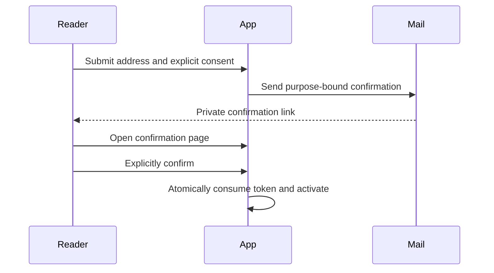

Uploads and confirmation links cross a trust boundary. A browser can improve the interaction, but the server must decide what is accepted. These are design recipes rather than copy-and-deploy security implementations.

## Validate an upload twice

Use an explicit file label and an accept hint in the interface. Check size before starting the request so a user gets a useful message. On the server, enforce authentication where needed, authorization, body size, permitted content, and storage destination independently. A client MIME type or filename extension is not proof of file contents.

```javascript
export function checkUploadHint(file, maximumBytes = 2_000_000) {
  if (!file || file.size <= 0) return 'Choose a non-empty file.';
  if (file.size > maximumBytes) return 'Choose a smaller file.';
  return null;
}
```

This is only a browser hint. Production processing may need format decoding, malware scanning, safe generated filenames, metadata removal, and isolated delivery. Do not serve untrusted active content from a privileged application origin. Private and public storage need different access policies.

## Confirm an email address deliberately



Generate an unpredictable token or a carefully verified signed token. Bind it to a purpose and expiry, protect it from logs, and make successful consumption atomic. Opening a GET link should show a page rather than silently changing subscription state; link scanners and previews may visit it before the reader does.

## Handle retries without duplicate effects

A delivery timeout does not establish whether the provider accepted the message. Use provider-supported idempotency for sends and a durable state transition for confirmation. A welcome-email failure should not quietly undo an already confirmed subscription. Respect suppression and unsubscribe decisions.

## Test the uncomfortable cases

Try an expired token, wrong purpose, repeated confirmation, simultaneous submissions, oversized files, misleading extensions, and an upstream outage. Never use real recipient tokens in fixtures. See [website forms](/api-reference/forms), [email maintenance](/maintaining/email), and the [starter README](/notes/starters) for scope boundaries.
